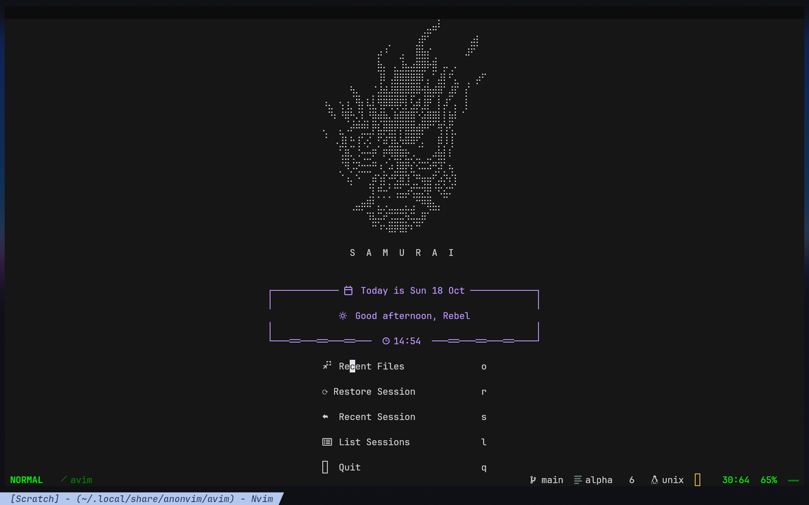
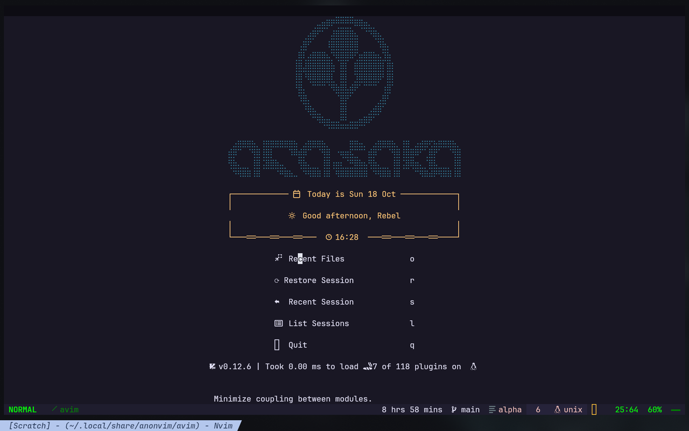
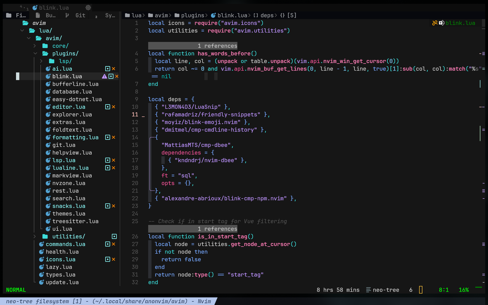
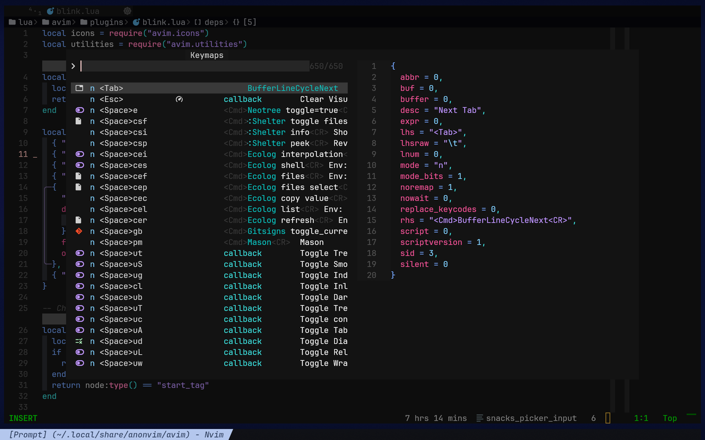
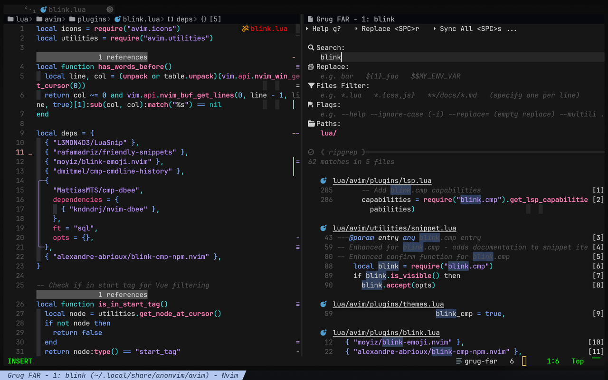
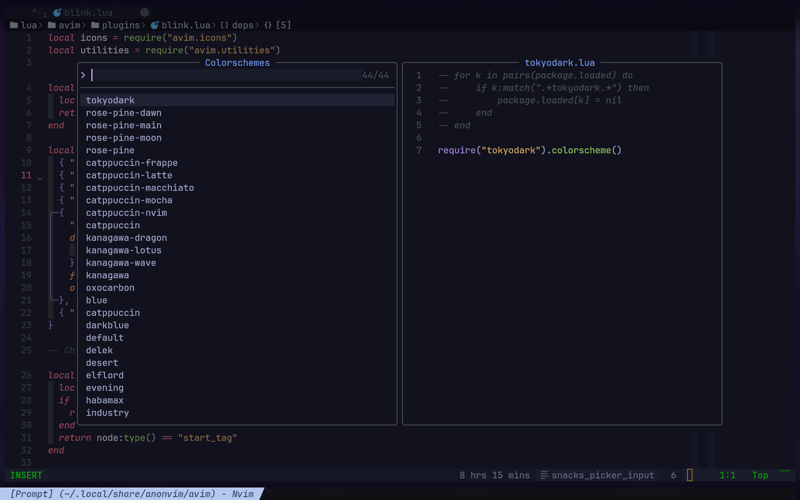
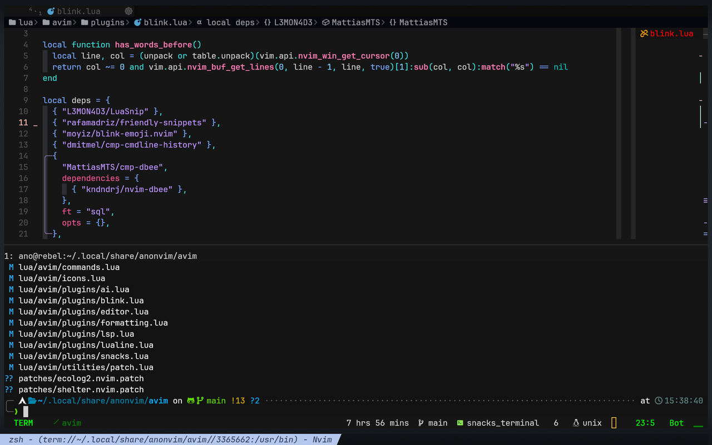
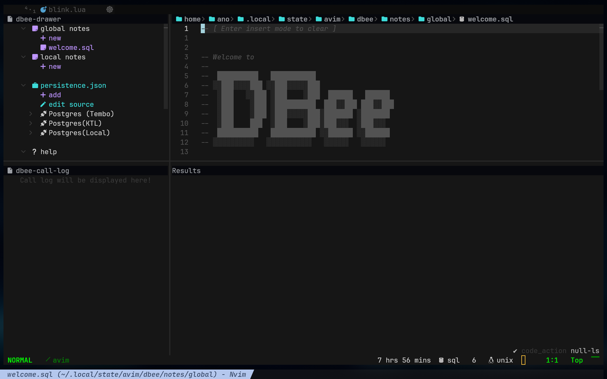

# AnoNvim



A modern, feature-rich Neovim configuration focused on providing a complete development environment. Built with Lua and
designed for extensibility.

## Features

- 🚀 Performance

  - Fast startup with lazy loading and optimized initialization
  - Efficient plugin management with Lazy.nvim
  - Startup profiling support (AVIM_PROFILE env var)
  - Optimized file operations with better error handling

- 🎨 User Interface

  - Dynamic theme switching based on time
  - Beautiful and functional UI components with Snacks.nvim
  - Random Alpha logos/banners
  - Winbar with context information (Dropbar)
  - Advanced file picker with line number jump support (:123 syntax)

- 📝 Development

  - Advanced LSP integration with buffer-local keymaps
  - Modern completion engine with Blink.cmp
  - AI coding assistant (CodeCompanion)
  - Git integration with conflict resolution
  - Database integration with Dbee
  - Unified logging system (all logs go to avim.log)

- 🔧 Tools & Utilities

  - Fuzzy finding with Snacks picker (with preview highlighting)
  - File tree with mini.files and NeoTree
  - Terminal integration with floating and split options
  - REST API client
  - Session management with Persisted
  - Advanced search and replace with GrugFar
  - Multiple cursors support

- ⚙️ Configuration
  - Type checking and linting
  - Automatic package management with Mason
  - Extensive customization options
  - Well-documented codebase with type annotations
  - Custom update system (:AnoUpdate, :AnoCheckUpdate, :AnoVersion)

## Requirements

- Neovim >= 0.12.0
- Git >= 2.19.0
- A [Nerd Font](https://www.nerdfonts.com/) (Optional but recommended)
- For optional features:
  - Node.js >= 20.18
  - Python >= 3.10
  - Go >= 1.23
  - Rust ( >= latest stable)

> Neovim 0.12 is a hard requirement, not a recommendation: the config uses the native `vim.lsp.config` /
> `vim.lsp.enable` API, `vim.lsp.codelens.enable`, and Mason 2.0 patterns, none of which exist on earlier releases.
> `:checkhealth avim` reports an error below that floor.

> The installer provisions the toolchain with [mise](https://mise.jdx.dev/) (`neovim`, `node`, `python`, `rust`,
> `luajit`, `tree-sitter`, `ripgrep`, `fd`, `fzf`) and installs Python packages (`pynvim`) with
> [uv](https://docs.astral.sh/uv/). It also adds the [activation line](https://mise.jdx.dev/shell-setup.html) for your
> shell so the tools are on `PATH`. Pass `--no-install-dependencies` to manage all of that yourself.

## Installation

```bash
bash <(curl -s https://raw.githubusercontent.com/AnoRebel/AnoNvim/main/.install/installer.sh)
```

### Installation Options

```bash
Options:
    -h, --help                    Print this help message
    -l, --local                   Install local copy of AnoNvim
    -y, --yes                     Automatic yes to prompts
    --overwrite                   Replace an existing AnoNvim directory/link without asking
    --no-install-dependencies     Skip dependency installation (mise toolchains, uv packages)
```

After installation:

1. Run `avim` to start AnoNvim
2. Initial setup will install required plugins

### Docker

Try AnoNvim without touching your host setup. The image uses [mise](https://mise.jdx.dev/) to provision Neovim and the
toolchains plugins need at build time (Node, Python, Rust, LuaJIT, tree-sitter), so it works the same on any host.

```bash
docker build -t anonvim .
docker run -it --rm anonvim

# or work on a real project inside the container
docker run -it --rm -v "$PWD:/work" -w /work anonvim
```

Neovim tracks `latest` and Node tracks `lts` by default. Pin them for a reproducible image:

```bash
docker build --build-arg NVIM_VERSION=0.12.4 --build-arg NODE_VERSION=24 -t anonvim .
```

The build fails loudly if the resolved Neovim is older than the required 0.12.

## Directory Structure

```lua
.
├── init.lua                  # Main entry point
├── lua/avim
│   ├── core                  # Core functionality
│   │   ├── defaults.lua      # Default settings
│   │   ├── init.lua          # Core initialization
│   │   ├── log.lua           # Logging system
│   │   └── settings.lua      # Neovim settings
│   ├── commands.lua          # Commands and autocommand definitions
│   ├── health.lua            # Health check
│   ├── icons.lua             # Icon definitions
│   ├── lazy.lua              # Plugin management
│   ├── update.lua            # Update system
│   ├── plugins               # Plugin configurations
│   │   ├── ai.lua            # AI related configurations
│   │   ├── bufferline.lua    # Bufferline(top bar) configurations
│   │   ├── blink.lua         # Code completion (blink.cmp) configurations
│   │   ├── database.lua      # Database configurations
│   │   ├── editor.lua        # Editor configurations
│   │   ├── explorer.lua      # File explorer configurations
│   │   ├── extras.lua        # Extra plugin configurations
│   │   ├── formatting.lua    # Code formatting configurations
│   │   ├── git.lua           # Git configurations
│   │   ├── lsp.lua           # LSP configurations
│   │   ├── lualine.lua       # Lualine(bottom bar) configurations
│   │   ├── rest.lua          # Rest client configurations
│   │   ├── search.lua        # Search and Replace configurations
│   │   ├── snacks.lua        # Folke's Snacks configurations
│   │   ├── themes.lua        # Themes configurations
│   │   ├── treesitter.lua    # Treesitter configurations
│   │   ├── ...               # Other plugin configurations
│   │   └── ui.lua            # UI components and configurations
│   └── utilities             # Utility functions
├── patches                   # Local patches applied to third-party plugins
└── Dockerfile                # Containerized AnoNvim (mise-provisioned)
```

### Plugin patches

Some plugins carry local fixes that upstream has not adopted. Rather than editing the plugin in place — which is lost on
the next update — each fix lives as a patch in `patches/`, applied by `lua/avim/utilities/patch.lua`.

lazy.nvim checks a plugin out with `git checkout`, which refuses to run while a tracked file has local changes, so every
patch is reversed before lazy installs, updates or restores and re-applied once the operation finishes. A `build` hook
re-applies it for fresh clones, so a plugin is never left unpatched after `:Lazy sync`.

Patching is idempotent, and a patch that no longer applies is **refused** with an error rather than written as conflict
markers, since a Lua file containing `<<<<<<<` would break startup far from the cause. If you see such an error, the
plugin is left at pristine upstream and the patch needs rebasing against the new source.

To add one:

```bash
# make your edit inside the plugin checkout, then:
git -C ~/.local/share/anonvim/lazy/<plugin> diff > patches/<plugin>.patch
```

Then add `build = require("avim.utilities.patch").builder("<plugin>")` to its spec.

## Key Bindings

AnoNvim provides multiple ways to explore keybindings:

1. **Keymaps Search**:

   - `Snacks.picker.keymaps()` or `<leader>fk`

2. **Which Key**:
   - Press `<leader>` to see available key bindings
   - Context-aware key suggestions

Note: `<leader>` key is mapped to the `Space` key

## Plugin Categories

<details><summary>🧠 AI Assistance</summary>

- [CodeCompanion](https://github.com/olimorris/codecompanion.nvim) - AI coding assistant

</details>

<details><summary>📝 Editor Enhancement</summary>

- [Alpha](https://github.com/goolord/alpha-nvim) - Startup screen
- [Blink.cmp](https://github.com/Saghen/blink.cmp) - Modern completion engine
- [Comment](https://github.com/numToStr/Comment.nvim) - Code commenting
- [Surround](https://github.com/kylechui/nvim-surround) - Text surroundings
- [Which Key](https://github.com/folke/which-key.nvim) - Key binding helper
- [Multiple Cursors](https://github.com/brenton-leighton/multiple-cursors.nvim) - Multiple cursors

</details>

<details><summary>🎨 User Interface</summary>

- [Dropbar](https://github.com/Beekaboo/dropbar.nvim) - VS Code-like winbar
- [Bufferline](https://github.com/akinsho/bufferline.nvim) - Buffer line
- [Lualine](https://github.com/nvim-lualine/lualine.nvim) - Status line
- [NeoTree](https://github.com/nvim-neo-tree/neo-tree.nvim) - File explorer
- [mini.files](https://github.com/nvim-mini/mini.files) - Vim-style file explorer
- [Markview](https://github.com/OXY2DEV/markview.nvim) - In-buffer markdown preview
- [Helpview](https://github.com/OXY2DEV/helpview.nvim) - In-buffer help rendering
- [Snacks](https://github.com/folke/snacks.nvim) - Fuzzy finder

</details>

<details><summary>🛠️ Development Tools</summary>

- [LSP](https://github.com/neovim/nvim-lspconfig) - Language Server Protocol
- [Treesitter](https://github.com/nvim-treesitter/nvim-treesitter) - Syntax parsing and highlighting
- [None-LS](https://github.com/nvimtools/none-ls.nvim) - Language Server Protocol (extras)
- [Lazy](https://github.com/folke/lazy.nvim) - Plugin management
- [Mason](https://github.com/williamboman/mason.nvim) - Package management
- [Rest APIs](https://github.com/rest-nvim/rest.nvim) - REST client
- [Persisted](https://github.com/olimorris/persisted.nvim) - Session management
- [Easy-Dotnet](https://github.com/GustavEikaas/easy-dotnet.nvim) - .NET project tooling

</details>

<details><summary>📦 Git Integration</summary>

- [Gitsigns](https://github.com/lewis6991/gitsigns.nvim) - Git decorations
- [Diffview+](https://github.com/dlyongemallo/diffview-plus.nvim) - Git diff viewer
- [Conflict](https://github.com/akinsho/git-conflict.nvim) - Conflict resolution

</details>

## Gallery

<details><summary>Screenshots (Click to expand)</summary>

  
  


</details>

## Credits

Built upon the great works of:

- [CosmicVim](https://github.com/CosmicNvim/CosmicNvim)
- [LunarVim](https://github.com/LunarVim/LunarVim)
- [NvChad](https://github.com/NvChad/NvChad)
- [LazyVim](https://lazyvim.org)
- [DomacsVim](https://github.com/DomacsVim/DomacsVim)
- [b0o's config](https://github.com/b0o/nvim-conf)
- [omega-nvim](https://github.com/max397574/omega-nvim)

## Contributing

Contributions are welcome! Please feel free to submit a Pull Request.

## License

MIT License - see [LICENSE](LICENSE) for more details.
